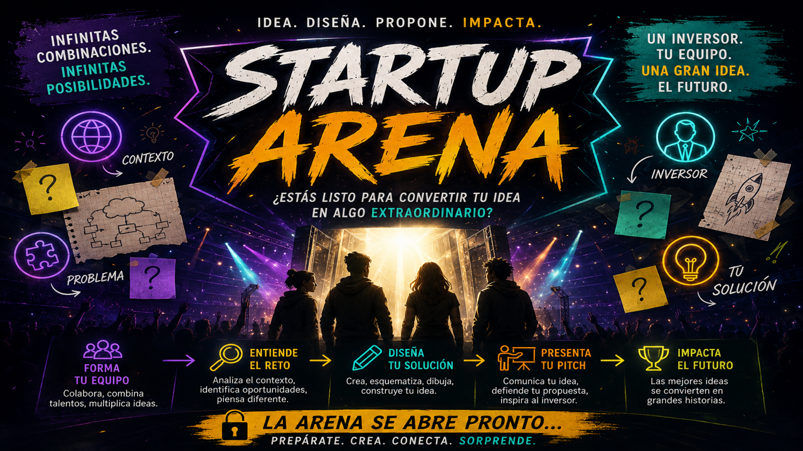

# Startup Arena

Actividad de diseño de software para estudiantes de **6.º semestre de Ingeniería**, en la asignatura **Diseño detallado de Software**. Cada equipo combina un contexto, un problema y un inversionista para diseñar una solución, representarla a mano con notación no formal y presentar un pitch.



## Abrir la aplicación

1. Descarga el repositorio desde **Code → Download ZIP** y extrae su contenido, o clónalo con Git.
2. Abre **`index.html`** en un navegador moderno, como Chrome, Edge o Firefox.
3. Conserva `index.html` y la carpeta **`assets/`** juntos.

Funciona **sin servidor, sin registro y sin conexión a internet**. No requiere instalar dependencias para utilizarla.

## Qué incluye

- **La actividad:** objetivo, competencias, dinámica, ejemplos y entregables para los estudiantes.
- **Sorteo y equipos:** registro de nombres únicos y asignación aleatoria de 13 contextos, 10 problemas y 10 inversionistas. Ninguna tarjeta se repite dentro de una ronda, que admite hasta 10 equipos.
- **Tiempos por equipo:** duración total y minuto de llegada del cambio del inversionista. El reloj comienza al sortear y el cambio se revela automáticamente.
- **Cambios de condiciones:** una restricción y una pregunta de discusión específicas para cada inversionista.
- **Entrega de soluciones:** imagen del modelo en notación no formal y confirmación manual de entrega.
- **Progreso:** tarjetas asignadas, cambio recibido y solución entregada.
- **Guía del docente:** instrucciones para conducir la actividad.
- **Evaluación:** diez criterios con respuestas **Sí / No**, una barra por equipo y guardado automático.
- **Resumen CSV:** equipo y porcentaje logrado. La descarga se habilita cuando todos los equipos tienen sus diez criterios respondidos.
- **Podium:** carrusel con los tres porcentajes distintos más altos y sus trofeos. Los empates comparten lugar: 90 % y 90 % ocupan P1; 80 % ocupa P2.
- **Vista de lectura:** transcripciones ampliadas de las tarjetas y descripciones debajo de las cuatro imágenes de «La actividad», conservando las imágenes.

## Flujo para el docente

1. Presenta **La actividad** y organiza los equipos.
2. En **Sorteo y equipos**, escribe el nombre y los tiempos. Por ejemplo, 30 minutos en total y cambio a los 15 minutos.
3. Pulsa **Sortear tarjetas**. El cambio debe estar programado después del inicio y antes del final.
4. Acompaña el diseño inicial y su ajuste cuando llegue la nueva condición del inversionista.
5. Después del cambio, adjunta la imagen del modelo y marca **Solución entregada** cuando corresponda.
6. Cuando finalicen los tiempos de todos los equipos, se abrirá **Evaluación**. Cada «Sí» suma 10 %; «No» no suma puntos, pero cuenta como criterio respondido.
7. Completa todos los criterios para habilitar **Descargar resumen de evaluación** y **Podium**.
8. Para empezar otra ronda, utiliza **Reiniciar sorteo** y confirma.

El fin del tiempo no marca una solución como entregada automáticamente. Los grupos de versiones anteriores pueden usar **Iniciar tiempos** sin cambiar sus tarjetas.

## Guardado y continuidad

Las asignaciones, los plazos, las condiciones del inversionista, las imágenes adjuntas, las entregas y las evaluaciones se guardan en `localStorage` del navegador. No se envían a un servidor ni se comparten entre equipos o computadores.

Usa el mismo navegador y mantén el archivo en la misma ubicación para continuar una ronda. Borrar los datos del navegador o confirmar **Reiniciar sorteo** elimina los datos de esa ronda. Los archivos del repositorio no contienen las rondas guardadas por los usuarios.

Los tiempos usan la hora de inicio y los plazos guardados: recargar no reinicia los relojes. Mantén la página abierta y el computador activo para ver los avisos al momento. Si cierras la página o el equipo se suspende, los eventos vencidos se aplicarán al regresar.

El interruptor **Vista de lectura** conserva su estado al cambiar de pestaña durante la misma apertura de la página. No activa lectura en voz alta.

Las imágenes de solución admiten PNG, JPG o WebP, hasta 15 MB por archivo de entrada. La aplicación intenta guardar una versión optimizada; si el navegador no dispone de espacio, muestra un mensaje y conserva los datos anteriores.

## Archivos del proyecto

```text
index.html              Aplicación en HTML, CSS y JavaScript puro
assets/cards/           Las 33 tarjetas originales
assets/activity/        Las cuatro ilustraciones de la actividad
assets/podium/          Los tres trofeos
scripts/build.py        Generador de la versión de un solo archivo
tests/                  Pruebas de lógica sin dependencias externas
```

Las 40 imágenes se incluyen como archivos separados para facilitar el mantenimiento en Git. El generador permite volver a integrarlas en un único HTML para distribuir la aplicación sin carpetas adicionales.

## Generar el HTML único y su ZIP

Requiere **Python 3** únicamente para generar los archivos de distribución. Desde la carpeta del proyecto:

```sh
python scripts/build.py
```

Se crean `dist/Startup-Arena.html` y `dist/Startup-Arena.zip`, con las 40 imágenes integradas. La carpeta `dist/` queda fuera del control de versiones. El HTML generado puede abrirse sin internet y sin Python.

## Pruebas

Requieren **Node.js 18 o posterior**. No hay paquetes que instalar:

```sh
node tests/run.cjs
```

También puedes ejecutar `npm test`. Las pruebas cubren el sorteo sin repeticiones, los duplicados, el guardado, los temporizadores, la entrega, la evaluación Sí / No, el bloqueo de descargas incompletas, el CSV, los empates del Podium y la vista de lectura. Utilizan un entorno simulado y no sustituyen una revisión visual en el navegador.

## Enfoque didáctico

La actividad desarrolla la aplicación del diseño de ingeniería a necesidades específicas y la comunicación con distintos públicos. Propone analizar requisitos, explicar decisiones técnicas y adaptar un modelo ante cambios de condiciones, considerando los intereses del inversionista y los efectos de la solución.

Los perfiles de inversionistas y su capital son elementos de una dinámica educativa ficticia.
